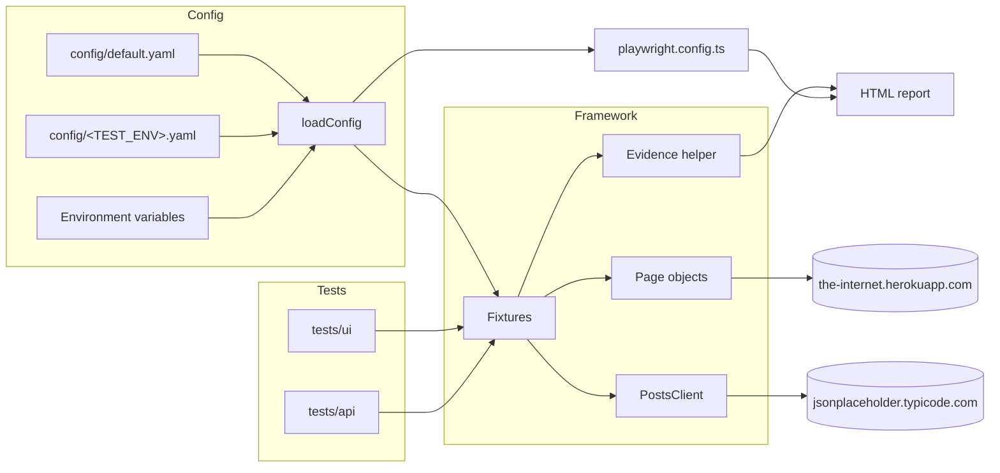

# playwright-ts-showcase

[](https://github.com/rsbarroco/playwright-ts-showcase/actions/workflows/tests.yml)


**Live test report:** https://rsbarroco.github.io/playwright-ts-showcase/

A compact, production-style test automation framework built with **Playwright** and **TypeScript**.
It covers browser UI tests and REST API tests in a single runner and shows the patterns used in
real-world suites: page objects, custom fixtures, layered configuration, annotated visual evidence
and CI with a published HTML report.

## Highlights

- **Page Object Model** with a small `BasePage` and one class per screen.
- **Custom fixtures** inject page objects, a typed API client, config and an evidence helper into every test.
- **Layered configuration**: YAML defaults → per-environment YAML → environment variables. No URLs or credentials hard-coded in tests.
- **Annotated evidence**: the asserted element is boxed and labeled before the screenshot, which is attached to the HTML report.
- **UI + API** in one run, split into Playwright projects.
- **No secrets in git**: credentials come only from environment variables or CI secrets, enforced by Gitleaks.
- **Quality gates**: ESLint (typescript-eslint + playwright plugin), Prettier and `tsc --strict`.
- **GitHub Actions** pipeline that runs checks and tests and uploads the HTML report as an artifact.

## Architecture



Tests only express intent (`loginPage.login(...)`, `posts.create(...)`, `evidence(locator, label)`);
selectors, endpoints and environment details live in the framework layer.

## Systems under test

| Layer | Target                                                               | Why                                                       |
| ----- | -------------------------------------------------------------------- | --------------------------------------------------------- |
| UI    | [the-internet.herokuapp.com](https://the-internet.herokuapp.com)     | Public playground with auth, forms and dynamic content    |
| API   | [jsonplaceholder.typicode.com](https://jsonplaceholder.typicode.com) | Free, keyless fake REST API with stable, predictable data |

## Getting started

Requirements: Node.js 20+ (CI uses Node.js 24).

```bash
npm ci
npx playwright install --with-deps chromium

npm test              # all tests
npm run test:ui       # UI project only
npm run test:api      # API project only
npm run test:smoke    # tests tagged @smoke
npm run report        # open the last HTML report
npm run check         # lint + format check + typecheck
```

### Configuration

Values are resolved in this order (later wins):

1. `config/default.yaml`
2. `config/<TEST_ENV>.yaml` (for example `TEST_ENV=ci`)
3. Environment variables: `UI_BASE_URL`, `API_BASE_URL`, `UI_USERNAME`, `UI_PASSWORD`

No credentials are stored in this repository, not even demo ones. Login tests read them only from
`UI_USERNAME` and `UI_PASSWORD`. The demo site shows its test username and password on its own
[login page](https://the-internet.herokuapp.com/login); copy them from there and export them:

```bash
export UI_USERNAME='<username shown on the login page>'
export UI_PASSWORD='<password shown on the login page>'
npm test
```

On Windows PowerShell use `$env:UI_USERNAME = '...'`. A template is available in `.env.example`.
When the variables are missing, the login tests are **skipped** with a clear message and the rest of
the suite still runs. Code that needs credentials calls `requireUiCredentials()`, which throws a
descriptive error instead of sending empty values.

In CI, add `UI_USERNAME` and `UI_PASSWORD` as repository secrets
(**Settings → Secrets and variables → Actions**).

## Annotated evidence

```ts
await expect(secureAreaPage.flash).toContainText('You logged into a secure area!');
await evidence(secureAreaPage.flash, 'login success message');
```

The helper draws a colored, labeled box around the element, takes a full-page screenshot, attaches it
to the test in the HTML report and removes the overlay. Color and border width come from config.
Traces, videos and screenshots are also kept automatically for failed tests.

## Project structure

```text
.
├── .github/workflows/tests.yml   # CI: quality gates, tests, HTML report artifact
├── .gitleaks.toml              # secret scanning rules
├── config/
│   ├── default.yaml              # base configuration
│   └── ci.yaml                   # CI overrides (TEST_ENV=ci)
├── src/
│   ├── api/PostsClient.ts        # typed REST client
│   ├── config/config.ts          # YAML + env loader
│   ├── fixtures/index.ts         # custom Playwright fixtures
│   ├── pages/                    # page objects
│   └── utils/evidence.ts         # annotated screenshot helper
├── tests/
│   ├── api/                      # API and config tests
│   └── ui/                       # browser tests
├── playwright.config.ts
├── eslint.config.mjs
└── tsconfig.json
```

## CI

Every push to `main`, every pull request and manual dispatches run:

1. `quality`: ESLint, Prettier check and TypeScript typecheck.
2. `secrets-scan`: [Gitleaks](https://github.com/gitleaks/gitleaks) scans the full git history.
3. `e2e`: reads `UI_USERNAME` / `UI_PASSWORD` from repository secrets (login tests are skipped with a
   warning if they are not configured), installs Chromium, runs all tests (with retries on CI) and uploads `playwright-report/` as
   the **playwright-report** artifact, even when tests fail.
4. `deploy-report` (pushes to `main` only): publishes the same HTML report to GitHub Pages at
   https://rsbarroco.github.io/playwright-ts-showcase/.

## License

[MIT](LICENSE) © Rodrigo Barroco
